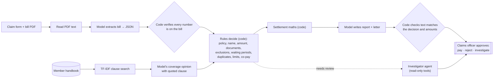

# AI-Assisted Health-Insurance Claim Processing (free, governed)

*Inspired by the open-source [ClaimTrackr](https://github.com/zep-analytics/GenAI-Project-InsuranceClaimAutomation)
project. Rebuilt for teaching with free tools, rule-based decisions and human sign-off. The insurer, members, hospitals
and bills are all fictional.*

## Problem statement
Health-insurance claims are slow and error-prone to process. An officer reads each hospital bill, finds the member's
policy, checks the handbook for exclusions, waiting periods and limits, works out the payable amount and writes a
report. Members wait, decisions are inconsistent, and mistakes cost money and trust.

## Objectives
- **Claim assessment:** read the bill, check it against the policy and handbook, calculate the payable amount and
  produce a report with a clear decision and the clauses behind it.
- **Member help desk:** answer questions about the membership handbook, citing clause numbers.
- **Governance:** no claim is paid, rejected or sent for investigation without a named claims officer.

## Key inputs
| Input | File |
|---|---|
| Member handbook (16 numbered clauses) | `data/member_handbook.pdf` |
| Policyholder records | `data/policyholders.csv` |
| Previous claims (for duplicate checks) | `data/past_claims.csv` |
| Submitted claim forms | `data/claims.csv` |
| Hospital bills | `data/bills/*.pdf` |

## How it works

| Step | Who does it |
|---|---|
| Read the bill into structured data | Model, then code checks every number against the bill |
| Find relevant handbook clauses | TF-IDF retrieval (free, no paid embeddings) |
| Decide: exclusions, waiting periods, limits, co-pay, duplicates | Code (written rules, same answer every time) |
| Second opinion on coverage | Model, quoting a clause; disagreement sends the claim to a person |
| Report and member letter | Model; code checks for contradictions and invented amounts |
| Final outcome | A claims officer |

## Sample claims and expected outcomes
| Claim | Situation | Expected outcome | Clause |
|---|---|---|---|
| CLM-1101 | Dengue fever, everything in order | Approve ₹37,200 | 2.1 |
| CLM-1102 | Claims ₹24,000 on an ₹18,400 bill | Reject | 6.4 |
| CLM-1103 | Alzheimer's disease | Reject | 4.1(b) |
| CLM-1104 | Cataract surgery 14 months into cover | Reject | 3.2 |
| CLM-1105 | Name on bill differs; discharge summary missing | Needs review | 7.1, 6.1 |
| CLM-1106 | Bill already paid in an earlier claim; submitted late | Needs review | 7.1, 6.2 |
| CLM-1107 | Member aged 66, private room above the limit, consumables billed | Part-pay ₹61,470 | 5.1, 5.2, 5.3 |

## What is different from ClaimTrackr
| ClaimTrackr | This project |
|---|---|
| Paid OpenAI model and embeddings | Free Groq model, free TF-IDF retrieval |
| Model decides accept or reject | Code decides from written rules; model gives a second opinion |
| Exclusions matched by word similarity | Keyword rules plus the model's quoted clause; disagreement goes to review |
| Rejects when claim exceeds bill, or on name mismatch | Rejects over-billing; sends name mismatches and duplicates to a person |
| No settlement maths | Room-rent cap, co-payment, non-payable items, remaining sum insured |
| Report is the output | Report and letter are checked, then a claims officer signs off |
| API key in the source file | Key in Colab secrets or Streamlit secrets, never in code |

## Run it
- **Colab:** upload `p11_claim_automation.ipynb`, add `GROQ_API_KEY` as a Colab secret, then *Runtime → Run all*.
- **App:** from the repository root, `pip install -r requirements.txt` then `streamlit run p11_claim_automation/app.py`.
- **Regenerate the sample PDFs:** `python tools/make_claims_data.py` (needs `reportlab`).

## Limits
This is a teaching prototype. Bills must be text PDFs (for scans, add a vision model as in project 03). The rules
cover only the sample handbook. Real claim decisions are regulated and need audited rules, privacy controls and
qualified staff.
